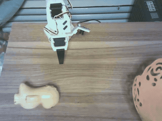

# Real-World Imitation Learning and VLA Benchmarking on SO-101

一个基于真实 SO-101 机械臂的 Robot Learning 闭环项目。以“抓取软体玩偶并放入篮子”为可重复任务，串起主从示范、数据清洗、多种 Policy 训练、远程推理、串口执行、泛化复测、人工纠正和延迟诊断。

项目围绕三条问题线展开：

1. **不同 Policy 在真实硬件上的执行差异**：ACT、Diffusion Policy、π0、π0.5 和 π0.5 Training-Time RTC 在同一任务上的真机表现如何；
2. **固定场景成功与空间泛化之间的差距**：玩偶改变位置后，模型从哪里开始偏移，针对性数据迭代能否改善结果；
3. **远程 VLA 如何接入真实控制回路**：观测时效、网络往返、模型计算、动作块接续和舵机反馈如何共同影响执行。

**ACT · Diffusion Policy · π0 · π0.5 · DAgger · Training-Time RTC**

## 关键结果

| 实验 | 结果 | 证据范围 |
| --- | --- | --- |
| 固定点位真机评测 | 47/50，94% | 五种策略，各 10 个已评分回合 |
| 玩偶前移 3 cm | 20% → 70% | π0.5 Training-Time RTC + DAgger，各阶段 10 回合 |
| 玩偶侧移 6 cm | 30% → 90% | π0.5 Training-Time RTC + DAgger，各阶段 10 回合 |
| DAgger 轨迹 | 35 条完整 episode | 自主帧和人工帧均保留，逐帧记录 `intervention` |

固定点位成绩说明任务在熟悉场景中的可执行性；位置变化结果说明真实失败状态上的数据迭代可以改善小范围空间变化。

## 真机 Demo

素材统一使用顶置相机、统一裁剪和 1.5 倍速播放。位置变化视频按实际场景标注。

<table>
<tr>
<td><br><b>ACT · 固定位置</b></td>
<td><br><b>Diffusion Policy · 固定位置</b></td>
<td><br><b>π0 · 固定位置</b></td>
</tr>
<tr>
<td><br><b>π0.5 · 固定位置</b></td>
<td><br><b>π0.5 RTC · 固定位置</b></td>
<td><br><b>π0.5 RTC + DAgger · 侧移 6 厘米</b></td>
</tr>
<tr>
<td><br><b>π0.5 RTC + DAgger · 前移 3 厘米</b></td>
<td><br><b>DAgger · 模型出错后人工纠正</b></td>
<td><br><b>DAgger · 模型出错后人工纠正</b></td>
</tr>
</table>

两条 DAgger 轨迹都从模型自主执行开始，模型出现偏移后由人工接管并完成剩余任务。

## 项目闭环

```text
主臂遥操作 / 人工接管 + 从臂反馈 + 顶置/腕部双摄
                           ↓
                 时间对齐、数据记录、归一化
                           ↓
        Mac mini 本地 ACT 或 RTX 5090 远程 Policy 服务
                           ↓
          观测上传 → 模型前向 → 动作块/RTC 接续
                           ↓
             从臂串口执行、反馈记录、人工评分
                           ↓
       模型行为 / 数据分布 / 延迟 / 通信 / 硬件分层诊断
                           ↓
            DAgger 纠正 → 有效窗口 → 混合训练
                           ↓
                    固定点位与位置泛化复测
```

项目中完成了采集、训练、部署和诊断链路的衔接：

- 通过 Ubuntu 虚拟机中的 ROS 2 完成主从遥操作和初始双摄 episode 采集，并保留状态、动作和时间戳；
- 在同一任务上训练和部署五种 Policy；
- 将本地 MPS 推理、远程 GPU 推理和官方 Training-Time RTC 接到同一类真机评分流程；
- 通过完整 DAgger episode 追踪模型偏移、人工接管和后续完成动作；
- 把相机帧年龄、网络往返、服务排队、模型计算、动作接纳、串口反馈和舵机状态分开记录。

## 系统架构


### 链路分工

- **Ubuntu 虚拟机采集链路**：承担主从遥操作、双摄话题、录制和初始示范数据采集。它与 ROS 2 控制器和 LeRobot episode 格式衔接紧密，适合稳定生成结构化训练数据；这条路径参与了正式采集和接口验证。
- **Mac 直接控制链路**：模型闭环需要更低的观测—动作延迟。虚拟机 USB/话题转发链路的额外时延会压缩动作接续余量，因此模型部署、DAgger 现场接管、回位、评分和延迟诊断改由 Mac mini 直接采集相机并持有从臂串口。这条路径也参与正式真机评测。
- **模型服务链路**：ACT 使用 Mac mini 的 Apple MPS；Diffusion Policy、π0 和 π0.5 使用 RTX 5090 上的项目 gRPC/RPC 服务；π0.5 Training-Time RTC 使用官方 Zenoh remote inference 服务。SSH 用于任务管理、端口转发和文件校验。

两条链路共同构成项目闭环：虚拟机解决示范采集和统一数据接口，Mac 解决低延迟执行和现场纠正。它们承担不同阶段，结果和日志按路径分别记录。

## 硬件与软件

### 真机端

- **机器人**：一对 SO-101 主臂/从臂，六个关节加平行夹爪；主臂用于示范和人工接管，从臂负责执行；
- **主机**：Apple Mac mini，M4 芯片，10 核 CPU，16 GB 内存，macOS 26.4；
- **相机**：顶置 `2M WebCam` 和腕部 `2M` 两路 UVC RGB 相机，640×480，名义 30 FPS；
- **通信**：主臂和从臂分别通过 USB 串口连接 Feetech 舵机总线；Ubuntu 虚拟机中的 ROS 2 承担采集话题，Mac 直接控制链路承担低延迟执行；状态和动作使用六维弧度表示；
- **本地软件**：Python 3.12.15、LeRobot 0.6.2、PyTorch 2.7.1、TorchVision 0.22.1、NumPy 2.2.6、PySerial 3.5。

### 训练与推理端

- **H100**：用于 π0、π0.5 和 Training-Time RTC 的训练，保存 checkpoint 和归一化统计；
- **RTX 5090**：32 GB 显存，用于远程 Diffusion Policy、π0、π0.5 和 RTC 服务；
- **远程环境**：Python 3.12.15、PyTorch 2.7.1+cu128、TorchVision 0.22.1+cu128、LeRobot 0.6.2、Eclipse Zenoh 1.10.1、Transformers 5.22.1、SentencePiece 0.2.2。

对于远程策略，Mac mini 发送时间对齐并 JPEG 编码后的双摄观测与关节状态；服务器完成模型前向和动作块生成；结果返回后由本地控制层执行并记录接纳时间、预测年龄和反馈状态。ACT 的模型前向在 Mac mini 的 Apple MPS 上完成。

## 数据采集与清洗

### 数据规模

| 阶段 | 数量 | 说明 |
| --- | ---: | --- |
| 原始主从采集 | 160 条 | 主从遥操作得到的原始示范 |
| 统一清洗候选 | 83 条 | 统一核查任务完整性、画面、时间轴、状态和动作，剔除异常或无法可靠对齐的回合 |
| 正式基线训练 | 75 条 | 从清洗候选中确定正式训练清单 `train75` |

每个 episode 记录顶置视角、腕部视角、六维 `observation.state`、六维 `action`、时间戳和 episode/frame 索引。DAgger 数据额外保存 `intervention`、原始帧索引和来源时间戳。

| 数据项 | 实际设置 |
| --- | --- |
| 采集方式 | 初始示范经 Ubuntu 虚拟机中的 ROS 2 主从遥操作采集；模型部署和 DAgger 纠正经 Mac 直接控制 |
| 视觉输入 | 顶置相机 + 腕部相机，640×480，名义 30 FPS |
| 状态与动作 | 六维关节/夹爪弧度状态与动作目标 |
| 远程执行频率 | π 系列与 Training-Time RTC 使用 20 Hz；采集时间轴保持 30 FPS |
| 场景变化 | 玩偶摆放、光照和室内外环境覆盖多种真实状态 |

### 数据多样性

采集过程中覆盖了不同摆放位置、光照和室内外场景，后续补采也保留了固定点位条件。

固定点位训练可以稳定完成标准抓取—放置；玩偶移动后，策略会把动作拉回训练中常见的旧位置。这个现象构成后续位置泛化和 DAgger 数据迭代的实验起点。

### 清洗依据

数据清洗分为三层：

1. **技术完整性**：检查四路 ROS 话题、消息数量、时间戳单调性、六维状态/动作、有限值和视频解码；时间轴存在内部缺口、图像损坏或无法解释的回合进入复核。
2. **任务有效性**：人工确认玩偶是否从篮外开始、是否真正夹住、搬运过程中是否掉落、是否进入篮子并在松爪后保持稳定。只把任务成功且技术完整的回合放入成功示范候选。
3. **训练一致性**：核对关节顺序、弧度单位、主从坐标映射、标定范围和图像—状态—动作的时间关系；状态/关节语义异常回合单独隔离，原始文件保留。

## Policy 训练

| Policy | 训练数据 | 步数 | Batch size | 学习率 | 初始化 | Seed | 训练/推理设备 |
| --- | --- | ---: | ---: | ---: | --- | ---: | --- |
| ACT | train75 | 50k | 32 | 1e-5 | - | 1000 | H100 / Mac MPS |
| Diffusion Policy | train75 | 50k | 64 | 1e-4 | - | 1000 | H100 / RTX 5090 |
| π0 | train75 | 20k | 32 | 2.5e-5 | `pi0_base` | 1000 | H100 / RTX 5090 |
| π0.5 | train75 | 20k | 64 | 2.5e-5 | `pi05_base` | 1000 | H100 / RTX 5090 |
| π0.5 Training-Time RTC | train75 | 20k | 64 | 2.5e-5 | `pi05_base` | 1000 | H100 / RTX 5090 |

π0、π0.5 和 Training-Time RTC 预测 50 步动作块。训练配置中的 `num_inference_steps` 为 10，真机远程服务的运行采样为 5 步；Training-Time RTC 使用 20 Hz、`execution_horizon=25`，允许的最大接续延迟为 20 步。

## 真机评测

### 评测协议

- **任务**：从固定起始姿态出发，抓取软体玩偶并放入篮子；
- **评分**：人工在每轮结束后记录任务成功或失败；
- **固定点位**：玩偶和篮子位置保持不变，用于比较不同 Policy 的基础执行能力；
- **位置泛化**：篮子、相机和起点保持不变，只移动玩偶；

### 固定点位

玩偶和篮子保持固定位置，每种策略完成 10 个已评分回合。

| Policy | 成功 | 回合 | 成功率 |
| --- | ---: | ---: | ---: |
| ACT | 10 | 10 | 100% |
| Diffusion Policy | 8 | 10 | 80% |
| π0 | 10 | 10 | 100% |
| π0.5 | 9 | 10 | 90% |
| π0.5 Training-Time RTC | 10 | 10 | 100% |
| **合计** | **47** | **50** | **94%** |

### 位置泛化

位置泛化只使用 π0.5 Training-Time RTC + DAgger。篮子、相机和起点保持不变，只改变玩偶位置。

| 条件 | DAgger 前 | DAgger 后 | 回合 |
| --- | ---: | ---: | ---: |
| 玩偶前移 3 cm | 20% | 70% | 10 |
| 玩偶侧移 6 cm | 30% | 90% | 10 |

结果支持小范围位置变化下的改进，结论范围止于已测玩偶、位移和场景条件。ACT、Diffusion Policy 和 π0 的位置泛化表现较弱，因此没有继续开展对应的独立位置变化评测；它们的公开结果限于固定点位协议。

## DAgger：从失败状态回收训练信号

DAgger 数据聚合围绕真实失败状态展开：

```text
75 条主从示范
      ↓
多种 Policy 训练与固定点位评测
      ↓
玩偶位置变化后仍抓取旧位置
      ↓
模型自主执行 → 暂停 → 主臂粗对齐/精对齐 → 人工完成剩余任务
      ↓
保存完整 episode，并用 intervention 标记动作来源
      ↓
提取连续有效人工窗口 → 与原始示范混合训练
      ↓
前移/侧移泛化复测
```

每条 DAgger episode 从起点开始保存：

- 自主阶段：`intervention=False`；
- 人工接管阶段：`intervention=True`；
- 完整轨迹用于回放、失败归因和 Demo；
- 连续有效人工窗口用于再训练；
- 暂停造成的时间断点不拼接；
- 硬件中止、复位失败和未来动作不足的尾段不进入训练窗口。

这个时间轴同时保留模型开始偏移的观测、人工纠正过程和纠正后的剩余动作。训练使用连续有效的人工窗口，完整 episode 用于追溯、行为分析和视频展示。

## RTC 与端到端延迟

π0.5 Training-Time RTC 使用 20 Hz、50 步动作块和 `execution_horizon=25`，允许的最大接续延迟为 20 步。

### 三类公开证据


同一类被动真机时延探针下，π0、Diffusion Policy 和 π0.5 Training-Time RTC 分别完成独立短时运行。图中是预测年龄的 median / p95 描述性统计，不能替代同 checkpoint、同网络状态、同场景的 RTC 因果消融。


三次连续 π0.5 RTC step-1000 真机运行记录显示，往返时间中位数约 240 ms，源帧年龄中位数约 355 ms；长尾样本对应启动、服务负载或相机时效波动。原始分布见 [`results/rtc_latency_distribution.csv`](results/rtc_latency_distribution.csv)。


动作轨迹图来自同一组已记录观测的离线回放，用于观察 20k 基线与 DAgger +1k checkpoint 的动作差异；回放没有向机械臂发送命令。原始轨迹见 [`results/rtc_action_trajectory.csv`](results/rtc_action_trajectory.csv)。

### 已定位的运行现象

- 一次预检测往返约 1.07 s，按 20 Hz 需要约 22 步接续，超过 20 步上限；官方拒绝该接续后，旧动作块播放完，队列耗尽；
- 一次运行中 540/540 条命令通过、18/18 个 RTC 结果接纳、串口无故障，但控制线程看到的相机帧年龄超过 0.2 s，运行因此停止；
- 队列耗尽、相机过期、模型响应失败和舵机故障在日志中分别记录，技术中止与策略任务失败分开统计。

目前没有在相同 checkpoint、网络状态和场景下，分别运行 Vanilla π0.5、Inference-Time RTC 与 Training-Time RTC 的成对对照。因此当前图表只能作为运行记录，不能单独把时延差异归因于某一种 RTC 方案。

### 现有固定点位的两组 RTC 对照

为了进一步量化动作接续，我们从两组各 10 回合的固定点位真机记录中提取了逐回合指标：普通 π0.5 使用 Inference-Time RTC，另一组使用 Training-Time RTC。

| 条件 | 成功率 | 预测/源帧年龄 median | 预测/源帧年龄 P95 | 请求往返 median | 服务端计算 median | 动作块边界跳变 P95 | jerk P95 |
| --- | ---: | ---: | ---: | ---: | ---: | ---: | ---: |
| π0.5 Inference-Time RTC | 9/10 | 644.7 ms | 942.8 ms | — | — | 0.038 rad | 219.8 rad/s³ |
| π0.5 Training-Time RTC | 10/10 | 514.2 ms | 637.1 ms | 397.0 ms | 173.7 ms | 0.032 rad | 182.4 rad/s³ |

Training-Time RTC 这组记录中，171 个预测有 149 个被接收，22 个被调度逻辑拒绝；最低动作队列余量的中位数为 0.93 秒，没有出现队列耗尽。这个结果说明当前记录中的 Training-Time RTC 接续更平稳，但两组 checkpoint、运行时间和网络状态没有做严格配对，因此只能作为工程对照，不能单独证明 RTC 机制带来的因果提升。

逐回合数据见 [`results/rtc_episode_metrics.csv`](results/rtc_episode_metrics.csv)，汇总见 [`results/rtc_comparison_summary.csv`](results/rtc_comparison_summary.csv)，提取脚本见 [`src/analyze_rtc_logs.py`](src/analyze_rtc_logs.py)。

## 工程问题与处理

### 固定点位过拟合

最初的训练数据主要来自室内固定位置。模型很容易把画面中的位置和动作绑在一起，玩偶挪开后，机械臂仍会朝原来的位置抓。我们让模型在真实失败状态下接受人工纠正，再用这些纠正轨迹继续训练。前移 3 cm 的成功率从 20% 提升到 70%，侧移 6 cm 从 30% 提升到 90%。

### DAgger 微调后的起点行为变化

加入纠正数据后，部分 checkpoint 虽然还能找到玩偶，却会在起点附近反复靠近，抬臂变慢。离线回放中，原始 20k checkpoint 大约第 17 个动作开始抬肩，+1000 步推迟到第 27 个动作，+2000 和 +3000 步约在第 26 个动作开始。动作后段仍然可以完成抬臂，说明这更像是起始阶段的动作分布被改变，而不能简单说成模型完全忘记了原任务。

### RTC 接续和动作队列

RTC 运行时，新预测不是每次都能及时接到正在执行的动作块后面。一次预检测往返约 1.07 秒，按 20 Hz 计算需要约 22 步接续，超过训练配置允许的 20 步。新动作被拒绝后，旧动作执行完，队列就会耗尽。这个过程后来单独记录了往返时间、接续步数、队列余量和等待状态，便于区分模型问题和通信问题。

### 相机帧时效和端到端延迟

有一次运行中，540 条命令全部下发成功，18 个 RTC 结果也都被接收，串口没有报错，但控制线程拿到的相机画面已经超过 0.2 秒。为了避免模型继续根据过时画面动作，程序主动停止。录像文件正常写入，并不代表控制线程拿到的就是及时画面，所以录制链路和控制链路需要分别检查。

### 人工接管与模型保护逻辑冲突

最初的 DAgger 人工接管仍然沿用了模型执行时的速度限制、相对目标限制和 `max_relative_target` 检查。人工移动主臂时，从臂因此跟不上，甚至在保存数据时停住。后来人工模式改回原始主从采集使用的 `Goal_Position` 控制方式，模型专用的目标距离检查不再干预人工纠正；底层的数值、物理边界、反馈和舵机故障检查仍然保留。

### 标定边界与坐标合同

`prediction_boundary_clamp` 不是随手设的数字，边界来自从臂当前的标定范围和物理可达范围。调试时曾发现人工映射生成的 `wrist_flex` 目标超出从臂实际范围，另外旧训练坐标和当前标定还存在零点差异。处理这类问题时，我们把训练坐标、主臂坐标和从臂执行坐标分开记录，避免把坐标转换问题误认为模型问题。

### DAgger 交互和数据集生命周期

在反复调试 DAgger 入口时，还遇到过一些看似简单但会影响采集的问题：提示没有显示在当前终端、暂停时按下的 `b` 被 shell 再次读到、旧的回位输入影响下一轮，以及数据集已经结束写入后仍继续追加。后来把提示和按键监听分开处理，人工完成整条任务统一用 `1` 结束，并在下一条 episode 开始时重新打开写入状态。

### 串口、舵机与相机故障

运行过程中还遇到过输入电压错误、ID6 读取失败、串口返回不完整、反馈速度异常和相机画面过期。这些问题分别来自供电或接头、串口通信、执行反馈和相机时效，不能统统算成模型失败。出现这类故障时，程序停止继续写入并保留现场日志，后续统计时与真正的任务失败分开计算。

## 当前结论

1. 五种策略在固定点位都具备任务执行能力，ACT、π0 和 π0.5 Training-Time RTC 达到 10/10；Diffusion Policy 和 π0.5 分别为 8/10、9/10。
2. 固定点位成功率不能代表位置泛化；针对真实失败状态采集并混合 DAgger 数据后，前移 3 cm 和侧移 6 cm 的成功率分别提升到 70% 和 90%。
3. 真实机器人上的策略效果由模型、数据分布、远程推理、动作接续、相机时效、串口执行和标定合同共同决定，端到端日志是分析这些因素的基础。

## 第三方组件

项目使用并参考 LeRobot、ACT、Diffusion Policy、π0/π0.5 及官方 DAgger/RTC 组件。许可与来源见 [`THIRD_PARTY_NOTICES.md`](THIRD_PARTY_NOTICES.md)。
