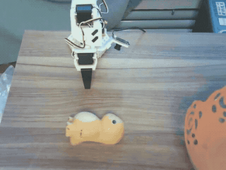

# SO-101 真机闭环：从数据到部署与评测

一个面向真实 SO-101 机械臂的闭环工程项目。抓取—放置是可重复的验证任务，项目围绕观测、数据、训练、推理、执行、延迟诊断、人工纠正和结果分析建立完整链路，并把每次实验的条件、结果与限制保留下来。

项目覆盖了从主从示范采集到远程推理、串口执行、DAgger 纠正、再训练和位置泛化复测的全过程。重点落在真实硬件上的工程判断：怎样区分模型问题、数据分布问题、链路延迟、队列调度、串口状态和机械臂执行误差。

## 项目概览

| 项目 | 内容 |
| --- | --- |
| 机器人 | SO-101，主从示范与从臂自主执行 |
| 观测 | 顶置与腕部双摄 RGB、关节反馈、时间戳 |
| 策略 | ACT、Diffusion Policy、π0、π0.5、π0.5 Training-Time RTC |
| 闭环 | 远程推理、动作块接续、串口反馈、人工接管、DAgger 再训练 |
| 公开证据 | 逐回合结果、训练曲线、精选 top-camera Demo、协议、架构和故障复盘 |

## 先看结果

### 固定点位真机评测

玩偶和篮子保持固定位置，每种策略完成 10 个已评分回合，使用同一类任务判据。

| 策略 | 成功 | 回合 | 成功率 |
| --- | ---: | ---: | ---: |
| ACT | 10 | 10 | 100% |
| Diffusion Policy（远程推理） | 8 | 10 | 80% |
| π0 | 10 | 10 | 100% |
| π0.5 | 9 | 10 | 90% |
| π0.5 Training-Time RTC | 10 | 10 | 100% |
| **合计** | **47** | **50** | **94%** |

### 位置泛化复测

位置泛化只使用 π0.5 Training-Time RTC + DAgger，篮子、相机和起点保持不变，仅改变玩偶位置。

| 条件 | DAgger 前 | DAgger 后 | 回合 |
| --- | ---: | ---: | ---: |
| 玩偶前移 3 cm | 20% | 70% | 10 |
| 玩偶侧移 6 cm | 30% | 90% | 10 |

这两组结果对应具体的位移和回合数，体现小范围位置变化下的改进幅度。ACT 与 Diffusion Policy 的公开结果限于固定点位协议，其他物体、光照或更大范围位置变化尚未纳入这组数字。

### 训练过程

公开快照记录了 π0 和 π0.5 的训练 loss、梯度范数和学习率。日志按每 200 步采样，当前训练记录中没有 validation loss，因此图中只呈现可追溯的训练曲线。


训练数据见 [`results/training_loss.csv`](results/training_loss.csv)，图表与数据保持同一采样口径。

## 真机 Demo

以下动图直接嵌入页面，统一使用 top 摄像头、统一裁剪和播放速度。位置泛化的展示标签按实际场景核对：采集目录中的 `forward3cm-attempt-006` 实际为侧移 6 cm，`lateral6cm-attempt-010` 实际为前移 3 cm。

<table>
<tr>
<td><br><b>ACT · fixed position</b></td>
<td><br><b>Diffusion Policy · fixed position</b></td>
<td><br><b>π0 · fixed position</b></td>
</tr>
<tr>
<td><br><b>π0.5 · fixed position</b></td>
<td><br><b>π0.5 RTC · fixed position</b></td>
<td><br><b>π0.5 RTC + DAgger · lateral 6 cm</b></td>
</tr>
<tr>
<td><br><b>π0.5 RTC + DAgger · forward 3 cm</b></td>
<td><br><b>DAgger · episode 000</b></td>
<td><br><b>DAgger · episode 001</b></td>
</tr>
</table>

[打开可控速播放的 Demo 页面](docs/demo.html)

DAgger 视频保留从自主执行到人工接管的完整时间轴；其余视频用于展示固定点位和位置变化下的成功执行。视频承担过程证据，逐回合 CSV 承担结果统计。

## 工程主线

项目按以下顺序推进：

1. **建立可观察的真机链路**：同步记录双摄、关节状态、模型目标、实际下发、机械臂反馈和人工评分。
2. **统一策略比较条件**：让 ACT、Diffusion Policy、π0、π0.5 和 π0.5 RTC 经过同一类相机、执行、回位和评分流程。
3. **拆解端到端延迟**：分别观察相机帧年龄、网络往返、服务端推理、动作块接续、RTC 余量、串口发送和反馈。
4. **把真实失败转成 DAgger 数据**：模型出现偏移后人工接管并完成剩余任务；完整轨迹保留，自主帧与人工帧用 `intervention=False/True` 区分。
5. **筛选训练窗口并再训练**：连续有效的人工纠正窗口进入训练，暂停断点、硬件中止和未来动作不足的尾段单独处理。
6. **复测并归因**：比较固定点位与位置变化，回到数据比例、起点监督、时间窗口和执行日志解释结果变化。

详细时间线与故障根因见 [`docs/project-journey.md`](docs/project-journey.md) 和 [`docs/failure-analysis.md`](docs/failure-analysis.md)。

## 系统结构

```text
双摄 RGB + 关节反馈
        ↓
时间对齐、数据记录与模型输入
        ↓
ACT / Diffusion Policy / π0 / π0.5 RTC
        ↓
远程推理、动作块接续、相机时效和延迟记录
        ↓
串口执行、关节反馈、硬件状态与人工评分
        ↓
模型 / 数据 / 延迟 / 通信 / 硬件的结果归因
        ↓
DAgger 人工纠正 → 训练窗口 → 再训练 → 泛化复测
```

模块职责和调用边界见 [`docs/architecture.md`](docs/architecture.md)，实验条件见 [`docs/experiment-protocol.md`](docs/experiment-protocol.md)。

## 结果与来源

- [`results/fixed_point.csv`](results/fixed_point.csv)：五种策略的固定点位结果；
- [`results/generalization.csv`](results/generalization.csv)：前移与侧移的 DAgger 前后对比；
- [`results/dagger_summary.csv`](results/dagger_summary.csv)：完整轨迹、人工纠正轨迹和 `intervention` 口径；
- [`results/training_loss.csv`](results/training_loss.csv)：训练曲线的公开数值快照；
- [`results/provenance.md`](results/provenance.md)：结果条件、分母、来源和复现层级。

公开副本聚焦可追溯的工程证据。完整权重、训练数据、原始录像、机器人标定、内部服务器和部署配置保留在私有工作区；结果表中的每个数字仍绑定具体条件、回合数和人工评分口径。

## 快速浏览

```bash
git clone https://github.com/CC-HH-NN/so101-real-robot-dagger.git
cd so101-real-robot-dagger
python3 -m http.server 8000
```

打开 `http://localhost:8000/docs/demo.html` 播放视频，或直接阅读 `results/` 与 `docs/`。页面浏览无需安装机器人环境。

## 相关项目调研

公开 SO-101 项目的 README 普遍采用“任务概述 → 硬件与数据 → 训练/推理 → 视频或结果 → 排错”的顺序。本项目参考了 [JereoZero/so101-real](https://github.com/JereoZero/so101-real)、[EmbodiedFX/LeRobot-SO101](https://github.com/EmbodiedFX/LeRobot-SO101)、[johnsutor/so101-nexus](https://github.com/johnsutor/so101-nexus)、[NVIDIA Sim-to-Real SO-101 Workshop](https://github.com/isaac-sim/Sim-to-Real-SO-101-Workshop) 和 [phosphobot](https://github.com/phospho-app/phosphobot) 的信息组织方式；逐项观察记录在 [`docs/related-projects.md`](docs/related-projects.md)。

## 第三方组件

项目使用并参考 LeRobot、ACT、Diffusion Policy、π0/π0.5 及官方 DAgger/RTC 组件。许可与来源见 [`THIRD_PARTY_NOTICES.md`](THIRD_PARTY_NOTICES.md)。
