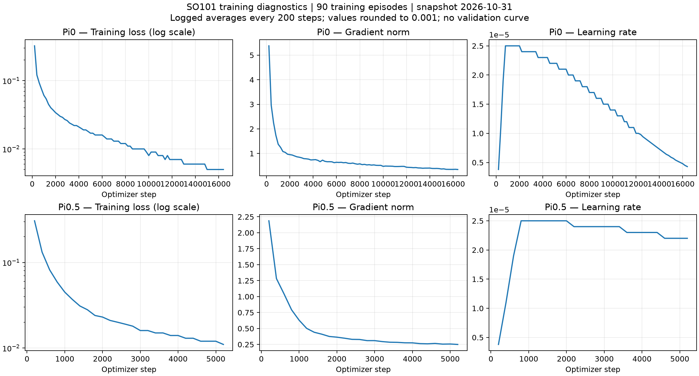
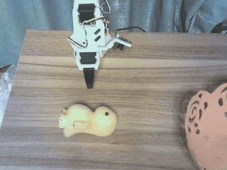
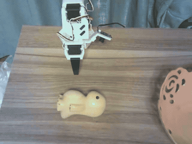

# SO-101 真机闭环：从数据到部署与评测

一个面向真实 SO-101 机械臂的闭环工程项目。抓取—放置是可重复的验证任务，项目重点在于把主从示范、数据处理、模型训练、远程推理、动作执行、延迟诊断、人工纠正和结果分析连成一条可追溯链路。

整个系统围绕一个实际问题展开：当机械臂没有完成任务时，如何判断原因来自数据分布、模型行为、推理延迟、动作队列、串口通信、标定坐标还是现场硬件，并把这个判断转化为下一轮工程改动。

## 项目概览

| 项目 | 实际设置 |
| --- | --- |
| 机器人 | 一对 SO-101 主臂/从臂，六个关节加夹爪；主臂用于示范和人工接管，从臂用于执行 |
| 视觉 | 顶置相机 + 腕部相机；640×480，名义 30 FPS，RGB 输入 |
| 数据 | LeRobot episode；双摄、关节状态、动作目标、实际下发、实测反馈和时间戳同步保存 |
| 策略 | ACT、Diffusion Policy、π0、π0.5、π0.5 Training-Time RTC |
| 纠正 | 官方 DAgger 状态机与本地人工接管、时间轴标记和训练窗口准备 |
| 主要证据 | 固定点位结果、位置泛化、训练曲线、完整 DAgger 轨迹、延迟日志和故障复盘 |

## 硬件与软件环境

### 真机端：Mac mini M4

真机端负责相机采集、两臂串口、动作执行、人工交互、录像和运行日志，也负责本地模型的推理与整条评测流程的编排。

- **主机**：Apple Mac mini，M4 芯片，10 核 CPU，16 GB 内存，macOS 26.4；
- **相机**：两路 UVC RGB 相机，顶置视角为 `2M WebCam`，腕部视角为 `2M`；
- **采集规格**：640×480、名义 30 FPS；远程 π/RTC 和 Diffusion Policy 链路使用 JPEG 编码，相机帧同时记录来源时间、接收时间和年龄；
- **机械臂通信**：主臂和从臂分别通过 USB 串口连接，使用 Feetech 舵机总线；运行时读取六关节反馈、扭矩状态、舵机错误位和实际速度；
- **本地软件**：Python 3.12.15、LeRobot 0.6.2、PyTorch 2.7.1、TorchVision 0.22.1、NumPy 2.2.6、PySerial 3.5；
- **本地推理**：ACT 使用 Apple MPS；Diffusion Policy 也做过本地 MPS 基准，但完整 DDPM 路径无法满足实时闭环，因此正式比较采用远程推理；
- **执行层**：六维弧度状态和动作、相机时间对齐、动作块队列、标定边界、反馈时效、串口状态和人工评分均在本地闭环中处理。

### 训练端：H100 集群

π0、π0.5 和 Training-Time RTC 的训练在集群 H100 GPU 上完成。训练阶段记录 checkpoint、归一化统计、训练 loss、梯度范数和学习率；训练输出经文件完整性核对后才进入部署流程。π0.5 Training-Time RTC 的训练配置为 20k steps，并在训练阶段加入 RTC 相关时序约束。

### 推理端：远程 RTX 5090 节点

远程节点负责 Diffusion Policy、π0、π0.5 和 π0.5 RTC 的模型服务。Mac mini 发送经过时间对齐和编码的双摄观测与关节状态，服务器完成模型前向和动作块生成，再把结果返回真机端执行。

- **GPU**：NVIDIA GeForce RTX 5090，32 GB 显存；评测按指定 GPU 隔离运行；
- **服务环境**：Python 3.12.15、PyTorch 2.7.1+cu128、TorchVision 0.22.1+cu128、LeRobot 0.6.2、NumPy 2.2.6、Eclipse Zenoh 1.10.1、Transformers 5.22.1、SentencePiece 0.2.2；
- **通信**：远程推理服务使用 RPC/Zenoh 传输观测和动作块；客户端记录上传、服务端接收、模型计算、结果返回和动作接纳时间；
- **服务模式**：Diffusion Policy 使用远程 V4 服务和 DDIM20/BF16/compile；π0 与 π0.5 使用远程 V4、Euler5、20 Hz；π0.5 RTC 使用官方 Training-Time RTC 服务，`delay=20`、`horizon=25`、20 Hz。

本地执行和远程推理的分工让硬件控制保持在真机端，同时把较重的模型计算放到 GPU 节点；延迟、时效和动作接续因此成为系统设计的一部分。

## 模型与部署配置

| 策略 | 训练/部署版本 | 推理位置 | 关键执行配置 |
| --- | --- | --- | --- |
| ACT | V4，train75，50k steps | Mac mini M4 / MPS | 本地视觉推理与从臂执行 |
| Diffusion Policy | V4，train75，50k steps | RTX 5090 | 远程服务，DDIM20，BF16，compile |
| π0 | V4，train75，20k steps | RTX 5090 | Euler5，20 Hz，动作块接续 |
| π0.5 | V4，train75，20k steps | RTX 5090 | Euler5，20 Hz，动作块接续 |
| π0.5 Training-Time RTC | V4，train75，20k steps | RTX 5090 | Training-Time RTC，delay 20，horizon 25，Euler5，20 Hz |

模型比较使用统一的真机任务、相机输入、动作单位、回位流程和人工评分。模型所在设备和推理协议单独记录，便于区分策略差异与部署链路差异。

## 数据与训练流程

### 主从示范

操作者通过主臂带动从臂完成抓取—放置，采集双摄画面和关节动作。数据记录同时保存观测时间、动作时间、主从状态、实际下发和反馈状态，训练前统一检查帧完整性、时间顺序、动作维度和归一化统计。

正式模型使用 75 条清洗后的示范训练。后续采集了 35 条 DAgger 完整轨迹，每条从起点记录到任务结束：

- 自主阶段写 `intervention=False`；
- 人工接管阶段写 `intervention=True`；
- 完整轨迹用于回放、展示和失败归因；
- 连续有效的人工纠正窗口用于再训练；
- 暂停造成的时间断点不拼接；
- 硬件中止、复位失败和未来动作不足的尾段单独标记，不进入训练窗口。

### DAgger 纠正

模型在真实场景中出现偏移后，操作者暂停模型，人工将主臂摆到与从臂接近的位置，完成粗对齐和精对齐，再接管主臂完成剩余抓取和放置。完整 episode 保存从错误发生前到任务完成的全部帧，训练时再根据 `intervention` 标记提取人工纠正段。

这个处理方式保留了三类信息：模型在什么观测下开始犯错、人工如何把状态拉回可执行区域、纠正后怎样完成剩余动作。完整轨迹可用于失败回放和数据比例分析，也能从中提取连续的再训练窗口。

## 评测结果

### 固定点位真机评测

玩偶和篮子保持固定位置，每种策略完成 10 个已评分回合。技术中止、相机时效和硬件通信故障单独记录，成功率分母为已完成任务评分的回合。

| 策略 | 成功 | 回合 | 成功率 |
| --- | ---: | ---: | ---: |
| ACT | 10 | 10 | 100% |
| Diffusion Policy（远程推理） | 8 | 10 | 80% |
| π0 | 10 | 10 | 100% |
| π0.5 | 9 | 10 | 90% |
| π0.5 Training-Time RTC | 10 | 10 | 100% |
| **合计** | **47** | **50** | **94%** |

### 位置泛化复测

位置泛化只使用 π0.5 Training-Time RTC + DAgger。篮子、相机和起点保持不变，只改变玩偶位置。

| 条件 | DAgger 前 | DAgger 后 | 回合 |
| --- | ---: | ---: | ---: |
| 玩偶前移 3 cm | 20% | 70% | 10 |
| 玩偶侧移 6 cm | 30% | 90% | 10 |

前移和侧移的结果绑定具体位移、回合数和成功判据，体现小范围位置变化下的改进幅度。ACT 与 Diffusion Policy 的公开结果限于固定点位协议，其他物体、光照和更大范围位移尚未纳入这组数字。

### 训练曲线

公开图表来自 π0 和 π0.5 的训练日志快照，记录每 200 步的 training loss、gradient norm 和 learning rate。当前训练记录没有 validation loss，图表保留原始训练曲线和日志缺口，不补造验证曲线。



对应数值在 [`results/training_loss.csv`](results/training_loss.csv)。

## 真机 Demo

以下动图直接嵌入页面，统一使用 top 摄像头、统一裁剪和播放速度。位置泛化的展示标签按实际场景核对：采集目录中的 `forward3cm-attempt-006` 实际为侧移 6 cm，`lateral6cm-attempt-010` 实际为前移 3 cm。

<table>
<tr>
<td><br><b>ACT · fixed position</b></td>
<td><br><b>Diffusion Policy · fixed position</b></td>
<td><br><b>π0 · fixed position</b></td>
</tr>
<tr>
<td><br><b>π0.5 · fixed position</b></td>
<td><br><b>π0.5 RTC · fixed position</b></td>
<td><br><b>π0.5 RTC + DAgger · lateral 6 cm</b></td>
</tr>
<tr>
<td><br><b>π0.5 RTC + DAgger · forward 3 cm</b></td>
<td><br><b>DAgger · episode 000</b></td>
<td><br><b>DAgger · episode 001</b></td>
</tr>
</table>

[打开可控速播放的 Demo 页面](docs/demo.html)

DAgger 视频保留从自主执行到人工接管的完整时间轴；其余视频展示固定点位和位置变化下的成功执行。

## 关键问题与工程处理

### 1. 固定点位稳定，位置变化后仍抓旧位置

室内补采数据集中在固定点位，早期数据才包含更多随意摆放的位置。模型在固定场景中学到的像素—动作对应关系过强，玩偶移动后仍朝旧坐标执行。位置变化基线为：前移 3 cm 成功率 20%，侧移 6 cm 成功率 30%。

处理方式是把真实失败转成 DAgger 数据：保留从起点开始的完整轨迹，人工完成剩余任务，再从连续纠正窗口中提取监督。处理后两组位置变化成功率分别升至 70% 和 90%。

### 2. DAgger 微调后起点动作变慢

部分微调 checkpoint 能识别玩偶，却在起点重复靠近或迟迟不抬臂。离线同观测回放显示，原始 20k checkpoint 约第 17 个动作开始抬肩，+1000 步约第 27 个动作，+2000/+3000 步约第 26 个动作；末段仍能完成抬臂，表现更接近起点监督被稀释和时序分布改变。

因此训练时保留原始示范的起点监督，并把 DAgger 纠正数据作为新增分布混合。1000、2000、3000 步 checkpoint 的离线回放和真机结果分别保存，训练 loss 与行为结果分开判断。

### 3. 远程推理长尾导致 Diffusion Policy 和 π 系列启动慢

远程服务的总延迟包含观测编码、网络往返、服务排队、模型计算、结果解码和动作接纳。单看模型前向时间无法代表端到端时效。Diffusion Policy 的远程 DDIM20/BF16/compile 路径因此采用独立的动作窗口和时效记录；π0/π0.5 则以 20 Hz 动作块和预测年龄监控运行。

所有运行同时记录预测年龄、命令间隔和服务端阶段时间。这样可以把模型没有输出、输出过期和机械臂没有跟上分开处理。

### 4. Training-Time RTC 队列耗尽

某次预检测得往返约 1.07 s，按 20 Hz 换算需要约 22 步接续，而训练期 RTC 最多支持 20 步。官方拒绝该接续后，旧动作块播放完，队列耗尽并停止。

处理方式包括启动前有界预检、运行中识别在途请求、短暂保持最近目标、记录需要的接续步数和队列余量。超过等待边界、请求超时、相机过期或服务锁存故障时停止，技术中止单独计账。

### 5. 相机帧超过时效

一次运行中 540/540 条命令通过、18/18 个 RTC 结果被接纳、串口无故障，但控制线程读到的相机帧年龄超过 0.2 s，运行停止。录像没有丢帧，说明写盘正常；控制线程的观测时效仍然已经失效。

处理方式是分别记录来源时间、接收时间、双摄时间差、JPEG/调度耗时和控制线程看到的帧年龄，把相机技术中止与模型失败分开。

### 6. 人工接管曾被模型保护逻辑拦截

早期 DAgger 接管路径复用了模型执行的速度、相对目标和目标距离检查，底层还重复执行 `max_relative_target`，导致主臂已经完成纠正，从臂却跟不上或在写入阶段停止。

人工模式随后改为与原始主从采集一致的 Goal_Position 语义，不重写每帧速度/加速度，也跳过模型专用的相对目标距离门限；有限值、物理位置边界、反馈时效、串口状态和舵机故障仍单独记录。模型模式继续使用自己的执行合同。

### 7. 标定边界与模型坐标不一致

人工映射曾产生超出从臂实际范围的 `wrist_flex` 目标。`prediction_boundary_clamp` 的边界来自当前机械臂标定 profile 和物理可达范围，属于硬件合同，并非为某次运行临时设置。旧训练坐标与当前标定还存在零点偏移，夹爪轴最明显。

处理方式是明确区分训练坐标、主臂坐标和从臂执行坐标，统一六轴零点变换；人工目标在写入前压回当前物理边界，同时保存原始目标和压回目标，模型阶段继续报告越界。

### 8. DAgger 交互和数据集生命周期问题

项目中出现过启动提示被日志重定向、按键 `b` 堆到 shell、成功后回位确认被旧输入覆盖，以及 writer finalize 后继续写入等问题。它们都发生在控制逻辑之外，却会直接中断采集。

处理方式是显式刷新终端提示、监听期间关闭 TTY 回显、停止监听后清理输入缓冲、为“人工完成整条任务”增加独立的 `1` 信号，并在新 episode 开始时恢复数据集写入生命周期。完整轨迹、纠正窗口和展示视频分别保存，避免混淆用途。

### 9. 串口和舵机硬件故障

运行中记录过输入电压错误、ID6 读取失败、通信状态不完整和反馈速度超限。它们来自舵机状态位、同步读事务或实际反馈，属于供电、接头、串口时序或硬件状态层面的故障。

故障锁存后停止继续写入，保持机械臂当前状态并保留现场日志；回位前重新确认卸力、路径和夹爪状态。没有硬件证据时，不把这类中止归因于模型。

## 系统闭环

```text
主臂示范 / 人工接管 + 从臂反馈 + 顶置/腕部双摄
                         ↓
              时间对齐、数据记录、归一化
                         ↓
       Mac M4 本地 ACT 或 RTX 5090 远程策略服务
                         ↓
        观测上传 → 模型前向 → 动作块/RTC 接续
                         ↓
             从臂串口执行、关节反馈、评分
                         ↓
      模型 / 数据 / 延迟 / 通信 / 硬件结果归因
                         ↓
          DAgger 纠正 → 训练窗口 → 再训练
                         ↓
                    泛化复测
```

## 结果文件

| 文件 | 内容 |
| --- | --- |
| `results/fixed_point.csv` | 五种策略的固定点位逐模型汇总 |
| `results/generalization.csv` | 前移 3 cm、侧移 6 cm 的 DAgger 前后结果 |
| `results/dagger_summary.csv` | 完整轨迹、人工纠正轨迹和 `intervention` 口径 |
| `results/training_loss.csv` | π0/π0.5 训练 loss、梯度范数和学习率快照 |
| `assets/figures/pi-training-curves.png` | 训练过程诊断图 |
| `assets/demo-gif/` | 9 条统一裁剪和处理的 top-camera 动图 |
| `src/` | DAgger 会话控制、纠正窗口准备和官方 RTC 接入的精选实现 |

## 快速浏览

```bash
git clone https://github.com/CC-HH-NN/so101-real-robot-dagger.git
cd so101-real-robot-dagger
python3 -m http.server 8000
```

打开 `http://localhost:8000/docs/demo.html` 播放视频。README 本身包含主要结果、训练图、硬件软件环境、闭环流程和故障复盘；`docs/` 与 `results/` 用于保存更细的协议和数据来源。

## 公开内容与资产边界

公开内容包括结果表、训练曲线、精选 Demo、实验协议、架构说明、故障复盘和与 DAgger/RTC 直接相关的代码。模型权重、训练数据、完整原始录像、机器人标定、内部服务器配置和运行日志留在私有工作区；结果表中的数字仍绑定具体条件、回合数和人工评分口径。

## 相关项目写法参考

README 的结构参考了公开 SO-101 项目常用的“任务概述 → 硬件与数据 → 训练/推理 → 视频与结果 → 排错”顺序，包括 [JereoZero/so101-real](https://github.com/JereoZero/so101-real)、[EmbodiedFX/LeRobot-SO101](https://github.com/EmbodiedFX/LeRobot-SO101)、[johnsutor/so101-nexus](https://github.com/johnsutor/so101-nexus)、[NVIDIA Sim-to-Real SO-101 Workshop](https://github.com/isaac-sim/Sim-to-Real-SO-101-Workshop) 和 [phosphobot](https://github.com/phospho-app/phosphobot)。

## 第三方组件

项目使用并参考 LeRobot、ACT、Diffusion Policy、π0/π0.5 及官方 DAgger/RTC 组件。许可与来源见 [`THIRD_PARTY_NOTICES.md`](THIRD_PARTY_NOTICES.md)。
