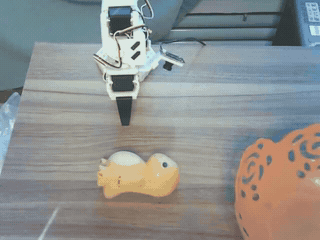

# SO101 真机闭环：从数据到部署与评测

一个面向真实 SO-101 机械臂的闭环工程项目。抓取—放置只是可重复的验证任务；项目重点是把观测、数据、训练、推理、执行、延迟诊断、人工纠正和结果分析接成一条可追溯链路。

这个仓库用来展示项目本身：真实机械臂如何被观测、训练、部署、诊断和改进。它不是从零复现实验的安装教程，也不上传模型权重、训练数据、完整原始录像、机器人标定或内部部署环境。

## 技术栈

- **机器人与数据**：SO-101、双摄 RGB、关节反馈、LeRobot 数据格式；
- **策略与推理**：ACT、Diffusion Policy、π0、π0.5、Training-Time RTC；
- **闭环工程**：远程推理、动作块接续、串口反馈、DAgger 人工接管；
- **证据形式**：逐回合 CSV、时间轴标记、精选 top-camera 视频和项目历程。

## 快速浏览

```bash
git clone https://github.com/CC-HH-NN/so101-real-robot-dagger.git
cd so101-real-robot-dagger
python3 -m http.server 8000
```

然后打开 `http://localhost:8000/docs/demo.html` 查看视频，或直接阅读 `results/` 和 `docs/`。运行网页不需要安装机器人环境。

## 结果先看

### 固定点位真机评测

| 策略 | 成功 | 回合 | 成功率 |
| --- | ---: | ---: | ---: |
| ACT | 10 | 10 | 100% |
| 远程 Diffusion Policy | 8 | 10 | 80% |
| π0 | 10 | 10 | 100% |
| π0.5 | 9 | 10 | 90% |
| π0.5 Training-Time RTC | 10 | 10 | 100% |
| **合计** | **47** | **50** | **94%** |

### 位置泛化复测

| 条件 | DAgger 前 | DAgger 后 | 回合 |
| --- | ---: | ---: | ---: |
| 玩偶前移 3 cm | 20% | 70% | 10 |
| 玩偶侧移 6 cm | 30% | 90% | 10 |

结果只支持这两种已测试的位置变化，不外推为任意物体或任意位置泛化。固定点位、泛化和 DAgger 的逐项口径见 [`results/`](results/)；原始真机运行记录留在私有工作区。

位置变化的公开结果来自 **π0.5 Training-Time RTC + DAgger**。ACT 和远程 DP 只在固定点位协议下报告，不能把固定点位成功率当作它们的位置泛化结果。

### 训练过程

公开日志中保留了 π0 和 π0.5 的训练 loss 快照。两条曲线都来自每 200 步记录的训练日志；当前训练记录没有 validation loss，因此图中不补画验证曲线。


图中同时保留梯度范数和学习率，便于把 loss 变化放回训练过程解释。原始数值见 [`results/training_loss.csv`](results/training_loss.csv)。

## Demo

下面的动图直接嵌入 README，展示的是已经裁剪并统一处理过的 top-camera 预览；原始视频和完整录制仍保留在私有工作区。

<table>
<tr>
<td><br><b>ACT · fixed position</b></td>
<td><br><b>Remote DP · fixed position</b></td>
<td><br><b>π0 · fixed position</b></td>
</tr>
<tr>
<td><br><b>π0.5 · fixed position</b></td>
<td><br><b>π0.5 RTC · fixed position</b></td>
<td><br><b>Position · forward 3 cm</b></td>
</tr>
<tr>
<td><br><b>Position · lateral 6 cm</b></td>
<td><br><b>DAgger · episode 000</b></td>
<td><br><b>DAgger · episode 001</b></td>
</tr>
</table>

## 我实际解决的问题

项目按“观察真机 → 统一比较策略 → 拆解延迟 → 把失败变成 DAgger 数据 → 再训练 → 泛化复测”推进，完整过程见 [`docs/project-journey.md`](docs/project-journey.md)。

- **数据采集与筛选**：同步双摄、关节反馈、模型目标、实际下发和实测状态；按真实时间轴切分连续人工纠正窗口，跨暂停不拼接未来动作。
- **训练数据管理**：区分完整轨迹归档和训练窗口；保留 `intervention=False/True` 标记，排除中断尾段和无效动作窗口。
- **多策略真机比较**：让 ACT、远程 DP、π0、π0.5 和 π0.5 RTC 使用同一任务、相机、执行链和评分标准。
- **端到端延迟诊断**：分别记录相机帧年龄、网络往返、服务端推理、动作块接续、RTC 余量、队列耗尽、串口反馈和舵机状态。
- **DAgger 闭环**：模型失败后人工接管并完成剩余任务，保存完整轨迹，再从连续纠正窗口生成再训练数据。
- **结果归因**：把模型失败、相机时效、网络问题、动作队列耗尽和硬件通信故障分开记录。

## 系统如何工作

```text
双摄 RGB + 关节反馈
        ↓
时间对齐与数据记录
        ↓
ACT / 远程 DP / π0 / π0.5 RTC
        ↓
推理、动作块接续与延迟监控
        ↓
串口执行、反馈与人工评分
        ↓
失败归因 → DAgger 纠正 → 数据筛选 → 再训练 → 泛化复测
```

模块职责和边界见 [`docs/architecture.md`](docs/architecture.md)，评分与数据口径见 [`docs/experiment-protocol.md`](docs/experiment-protocol.md)。

## Demo 与结果文件

[打开真实机械臂 Demo 页面](docs/demo.html)

页面包含 5 条固定点位视频、2 条 DAgger 完整轨迹和 2 条位置泛化视频，全部使用 top 摄像头。视频用于展示执行过程，不替代逐回合结果表。

- [`results/fixed_point.csv`](results/fixed_point.csv)：五种策略的固定点位结果；
- [`results/generalization.csv`](results/generalization.csv)：两种位置变化的前后对比；
- [`results/dagger_summary.csv`](results/dagger_summary.csv)：完整轨迹和人工纠正口径；
- [`results/provenance.md`](results/provenance.md)：结果来源、复现边界和内部运行记录映射。
- [`docs/related-projects.md`](docs/related-projects.md)：公开 SO-101 项目的 README 组织方式调研。

## 复现边界

这是一个经过脱敏的项目展示仓库，不把内部真机环境伪装成可直接复现的开源训练包。按 reproducible-runs 的五项标准，本仓库当前为 **1/5**：公开了结果表和协议，但没有公开依赖锁定环境、训练数据、评测入口、权重和完整结果生成脚本。

公开内容可以直接用于：

1. 阅读项目历程和系统边界；
2. 检查结果表的分母、条件和 DAgger 标记；
3. 打开 Demo 页面查看真实执行过程；
4. 阅读公开的 DAgger、RTC 和训练窗口处理代码。

完整复现需要私有的真机数据、checkpoint、标定、服务器环境和运行配置。每个结果的来源与限制记录在 [`results/provenance.md`](results/provenance.md) 中。

## 第三方说明

项目使用并参考 LeRobot、ACT、Diffusion Policy、π0/π0.5 及官方 DAgger/RTC 组件。详见 [`THIRD_PARTY_NOTICES.md`](THIRD_PARTY_NOTICES.md)。
