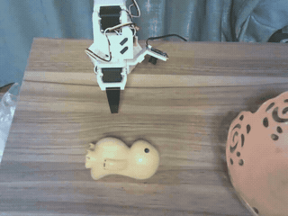
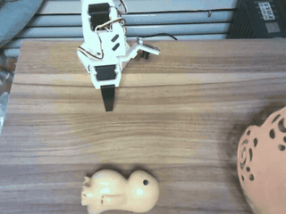
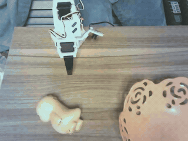
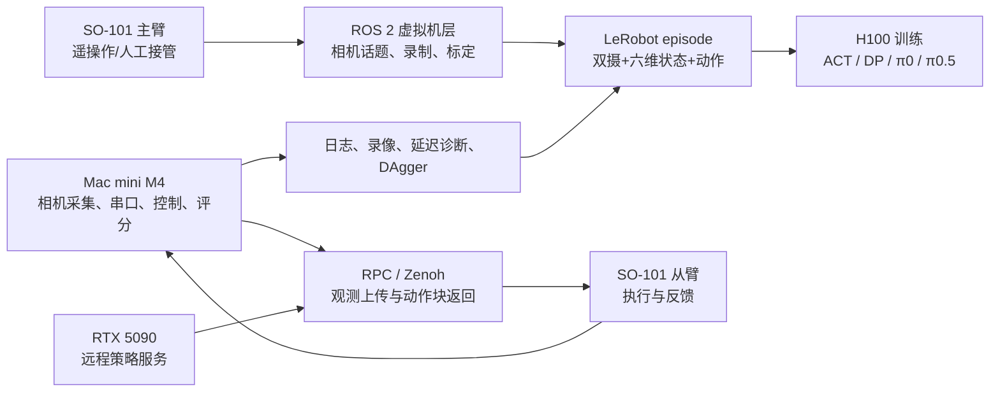
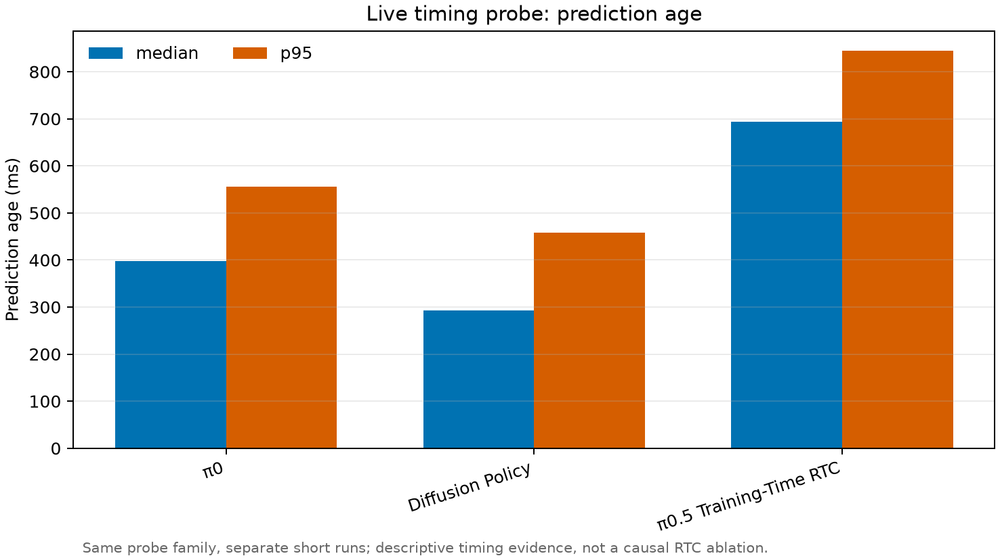
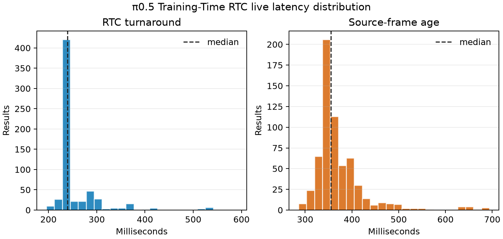
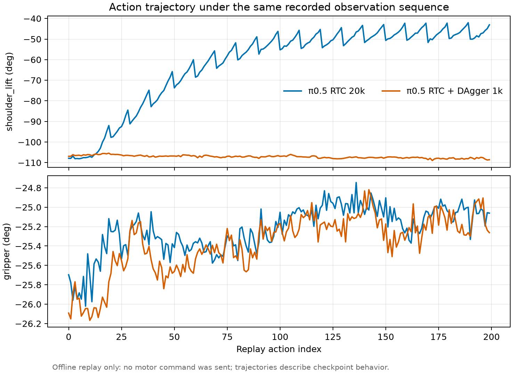

# SO-101 Real-World Policy Benchmark

一个基于真实 SO-101 机械臂的 Robot Learning 闭环项目。任务是抓取软体玩偶并放入篮子，项目记录从数据采集、清洗、训练、远程推理、串口执行、人工纠正到泛化复测的完整过程。

项目关注三个问题：不同 Policy 在真实硬件上的执行差异，固定场景训练与位置变化之间的泛化缺口，以及远程推理和动作块接续对真实控制的影响。

**ACT · Diffusion Policy · π0 · π0.5 · DAgger · Training-Time RTC**

## 项目亮点

- 在真实 SO-101 主从机械臂上完成双摄数据采集、策略训练和真机评测；
- 在同一抓取—放置任务上比较 ACT、Diffusion Policy、π0、π0.5 和 π0.5 Training-Time RTC；
- 用固定点位、前移 3 cm 和侧移 6 cm 三组条件区分任务执行能力与位置泛化能力；
- 保留 DAgger 从自主执行到人工接管的完整时间轴，并用 `intervention` 标记区分自主帧和人工帧；
- 将相机帧年龄、网络往返、模型计算、动作块余量、串口反馈和舵机状态放在同一条诊断链路中。

## 真机 Demo

以下素材统一使用顶置相机、统一裁剪和相近播放速度。前移/侧移标签按实际场景重新核对：原始目录名 `forward3cm-attempt-006` 实际对应侧移 6 cm，`lateral6cm-attempt-010` 实际对应前移 3 cm。

<table>
<tr>
<td><br><b>ACT · fixed position</b></td>
<td><br><b>Diffusion Policy · fixed position</b></td>
<td><br><b>π0 · fixed position</b></td>
</tr>
<tr>
<td><br><b>π0.5 · fixed position</b></td>
<td><br><b>π0.5 RTC · fixed position</b></td>
<td><br><b>π0.5 RTC + DAgger · lateral 6 cm</b></td>
</tr>
<tr>
<td><br><b>π0.5 RTC + DAgger · forward 3 cm</b></td>
<td><br><b>DAgger · episode 000</b></td>
<td><br><b>DAgger · episode 001</b></td>
</tr>
</table>

DAgger 两条轨迹保留从自主阶段到人工接管、再到任务完成的完整过程。当前展示页只放成功执行和完整纠正轨迹，失败原因在后文统一说明。

[打开可控速播放的 Demo 页面](docs/demo.html)

## 系统组成



系统分成三层：

1. **采集与兼容层**：虚拟机中的 ROS 2 用于主从遥操作、相机话题、录制和标定相关流程；
2. **真机控制层**：Mac mini 负责双摄采集、状态读取、串口动作下发、人工交互、回位和评分；
3. **模型服务层**：H100 用于训练，RTX 5090 用于远程推理。不同策略根据服务版本使用 gRPC/RPC 或官方 Zenoh 链路。

SSH 用于远程任务管理、端口转发和文件校验；实时观测与动作通过策略服务链路传输。

## 硬件与软件环境

### 真机端

- **机器人**：一对 SO-101 主臂/从臂，六个关节加平行夹爪；主臂用于遥操作和人工接管，从臂负责执行；
- **主机**：Apple Mac mini，M4 芯片，10 核 CPU，16 GB 内存，macOS 26.4；
- **相机**：顶置 `2M WebCam` 和腕部 `2M` 两路 UVC RGB 相机；640×480，名义 30 FPS；
- **执行接口**：主臂和从臂分别通过 USB 串口连接 Feetech 舵机总线，使用六维弧度状态和动作；
- **本地软件**：Python 3.12.15、LeRobot 0.6.2、PyTorch 2.7.1、TorchVision 0.22.1、NumPy 2.2.6、PySerial 3.5；
- **本地推理**：ACT 使用 Apple MPS；本地 Diffusion Policy 做过采样基准，正式真机比较采用远程推理。

### 训练端

π0、π0.5 和 Training-Time RTC 在 H100 集群上训练。训练输出包含 checkpoint、归一化统计、loss、梯度范数和学习率记录。π0.5 Training-Time RTC 基线训练为 20k steps，DAgger 迭代另有 1000、2000、3000 steps checkpoint 用于行为对照。

### 推理端

远程节点使用 NVIDIA RTX 5090，32 GB 显存。服务环境包含 Python 3.12.15、PyTorch 2.7.1+cu128、TorchVision 0.22.1+cu128、LeRobot 0.6.2、Eclipse Zenoh 1.10.1、Transformers 5.22.1 和 SentencePiece 0.2.2。

Mac mini 发送经过时间对齐和 JPEG 编码的双摄观测与关节状态，服务器完成模型前向和动作块生成，再把结果返回真机端。客户端同时记录上传、服务端接收、模型计算、结果返回、动作接纳和预测年龄。

## 数据采集与清洗

### 数据规模

| 阶段 | 数量 | 说明 |
| --- | ---: | --- |
| 原始主从采集 | 120 episodes | 首轮人工审核与技术筛选的输入 |
| 首轮清洗候选 | 108 episodes | 由技术候选与人工成功标记共同形成 |
| 正式基线训练 | 75 episodes | `train75` 模型配置使用的示范集合 |
| DAgger 完整轨迹 | 35 episodes | 从起点记录到任务结束，30 FPS，共 19,719 帧 |
| DAgger 有效训练窗口 | 18,004 windows | 每个窗口包含完整未来 50 步动作 |

双摄均为 640×480、30 FPS。每个 episode 记录顶置视角、腕部视角、六维 `observation.state`、六维 `action`、时间戳和 episode/frame 索引。DAgger 数据额外保存 `intervention`、原始帧索引和来源时间戳。

### 数据多样性与分布缺口

采集过程中覆盖了不同摆放位置、光照和室内外场景，后续补采也保留了固定点位条件。固定点位训练因此能够稳定完成标准任务，但玩偶位置发生变化时，策略会把动作拉回训练中常见的旧位置。

这个现象把问题从“模型是否能完成抓放”进一步拆成两个条件：固定场景中的任务执行，以及未直接示范位置上的空间泛化。

## Policy 训练与部署

| Policy | 训练数据 | 步数 | Batch size | 学习率 | 初始化 | Seed | 推理位置 |
| --- | --- | ---: | ---: | ---: | --- | ---: | --- |
| ACT | train75 | 50k | 32 | 1e-5 | 配置未指定预训练权重 | 1000 | Mac mini M4 / MPS |
| Diffusion Policy | train75 | 50k | 64 | 1e-4 | 配置未指定预训练权重 | 1000 | RTX 5090 |
| π0 | train75 | 20k | 32 | 2.5e-5 | `pi0_base` | 1000 | RTX 5090 |
| π0.5 | train75 | 20k | 64 | 2.5e-5 | `pi05_base` | 1000 | RTX 5090 |
| π0.5 Training-Time RTC | train75 | 20k | 64 | 2.5e-5 | `pi05_base` | 1000 | RTX 5090 |

π0、π0.5 和 Training-Time RTC 使用 50 步动作块与 10 步推理采样；RTC 训练合同的最大 delay 为 20。ACT、Diffusion Policy、π0 和 π0.5 的训练设置来自各自的固定实验配置，公开表格保留影响结果解释的核心参数。

π0 和 π0.5 使用预训练策略作为初始化，再在 SO-101 数据上微调；ACT 与 Diffusion Policy 的训练配置、checkpoint 和归一化统计保存在内部实验记录中。

训练曲线公开了 π0 和 π0.5 的 training loss、gradient norm 和 learning rate。当前训练记录没有 validation loss，因此图中只展示实际记录的训练曲线。


对应数值见 [`results/training_loss.csv`](results/training_loss.csv)。

## 真机评测结果

### 固定点位

玩偶和篮子保持固定位置，每种策略完成 10 个已评分回合。技术中止、相机时效和硬件通信问题单独记录，成功率分母为完成任务评分的回合。

| Policy | 成功 | 回合 | 成功率 |
| --- | ---: | ---: | ---: |
| ACT | 10 | 10 | 100% |
| Diffusion Policy | 8 | 10 | 80% |
| π0 | 10 | 10 | 100% |
| π0.5 | 9 | 10 | 90% |
| π0.5 Training-Time RTC | 10 | 10 | 100% |
| **合计** | **47** | **50** | **94%** |

### 位置泛化

位置泛化只使用 π0.5 Training-Time RTC + DAgger。篮子、相机和起点保持不变，只改变玩偶位置。

| 条件 | DAgger 前 | DAgger 后 | 回合 |
| --- | ---: | ---: | ---: |
| 玩偶前移 3 cm | 20% | 70% | 10 |
| 玩偶侧移 6 cm | 30% | 90% | 10 |

这些结果支持小范围位置变化下的改进，结论范围止于已测的玩偶、位置偏移和场景条件。

## DAgger：从失败状态回收训练信号

DAgger 迭代围绕真实失败状态展开：

```text
75 条主从示范
      ↓
多种 Policy 训练与固定点位评测
      ↓
玩偶位置变化后仍抓取旧位置
      ↓
模型自主执行 → 暂停 → 主臂粗对齐/精对齐 → 人工完成剩余任务
      ↓
保存完整 episode，并用 intervention 标记动作来源
      ↓
提取连续有效人工窗口 → 与原始示范混合训练
      ↓
前移/侧移泛化复测
```

每条 DAgger episode 从起点开始保存：

- 自主阶段：`intervention=False`；
- 人工接管阶段：`intervention=True`；
- 完整轨迹用于回放、失败归因和 Demo；
- 连续有效人工窗口用于再训练；
- 暂停造成的时间断点不拼接；
- 硬件中止、复位失败和未来动作不足的尾段不进入训练窗口。

这样可以同时观察模型从哪个状态开始偏移、人工如何把状态拉回可执行区域，以及纠正后如何完成剩余动作。

## RTC 与端到端延迟

π0.5 的 Training-Time RTC 使用训练期时序约束，服务端配置为 20 Hz、50 步动作块和 `execution_horizon=25`；训练合同中的 `rtc_training_max_delay=20` 限制可接受的接续延迟。

项目分别记录相机采集、JPEG 编码、网络往返、服务排队、模型计算、动作返回、动作接纳和机械臂反馈；模型前向时间只是其中一个阶段。

公开图表把三类证据分开呈现：



同一类被动真机时延探针下，π0、Diffusion Policy 和 π0.5 Training-Time RTC 分别完成独立短时运行。图中比较的是预测年龄的描述性统计，不能替代严格的同 checkpoint、同网络状态、同场景 RTC 消融。



三次连续的 π0.5 RTC step-1000 真机运行共记录 626 个官方结果。往返时间中位数约 240 ms，源帧年龄中位数约 355 ms；长尾样本对应启动、服务负载或相机时效波动。原始分布见 [`results/rtc_latency_distribution.csv`](results/rtc_latency_distribution.csv)。



动作轨迹图来自同一组已记录观测的离线回放，用于观察 20k 基线与 DAgger +1k checkpoint 的动作差异；回放没有向机械臂发送命令。原始轨迹见 [`results/rtc_action_trajectory.csv`](results/rtc_action_trajectory.csv)。

已经确认的运行现象包括：

- 一次预检测往返约 1.07 s，按 20 Hz 需要约 22 步接续，超过训练允许的 20 步，官方拒绝该接续后动作队列耗尽；
- 一次运行中 540/540 条命令通过、18/18 个 RTC 结果接纳、串口无故障，但控制线程看到的相机帧年龄超过 0.2 s，运行因此停止；
- 队列耗尽、相机过期、模型响应失败和舵机故障在日志中分别记录，避免将技术中止直接计为策略失败。

当前公开结果包含 Training-Time RTC 的固定点位、位置泛化和运行时诊断。Vanilla π0.5、Inference-Time RTC 与 Training-Time RTC 的严格同条件延迟消融仍缺少配对记录，因此图表保留为探针统计、真实运行分布和离线动作回放，不把它们写成因果提升。

## 关键工程问题

### 固定点位过拟合

室内固定点位补采强化了像素—动作对应关系，玩偶移动后策略仍朝旧位置抓取。DAgger 针对真实失败状态补充数据，前移 3 cm 从 20% 提升到 70%，侧移 6 cm 从 30% 提升到 90%。

### DAgger 微调后的起点行为变化

部分 checkpoint 能识别玩偶，却在起点重复靠近或迟迟不抬臂。离线同观测回放显示，原始 20k checkpoint 约第 17 个动作开始抬肩，+1000 步约第 27 个动作，+2000/+3000 步约第 26 个动作；末段仍能完成抬臂。现象与起点监督被稀释、时序分布改变相符，不能仅凭这一现象断言模型完全遗忘。

### 人工接管与模型保护逻辑冲突

早期 DAgger 接管路径复用了模型执行的速度、相对目标和目标距离检查，底层还重复执行 `max_relative_target`，导致人工纠正后从臂跟不上或在写入阶段停止。人工模式随后改用原始主从采集的 Goal_Position 语义；模型专用的目标距离检查不再作用于人工接管，有限值、物理边界、反馈时效、串口状态和舵机故障仍记录。

### 标定边界与坐标合同

`prediction_boundary_clamp` 的边界来自当前从臂标定 profile 和物理可达范围。人工映射曾产生超出 `wrist_flex` 实际范围的目标，旧训练坐标与当前标定还存在零点偏移。处理时区分训练坐标、主臂坐标和从臂执行坐标，记录原始目标与压回目标。

### DAgger 交互与数据集生命周期

项目曾出现启动提示被重定向、`b` 键堆积到 shell、回位确认被旧输入覆盖，以及 writer finalize 后继续写入等问题。处理方式包括显式刷新提示、监听期间关闭 TTY 回显、停止监听后清理输入缓冲、为人工完成整条任务设置独立的 `1` 信号，并在新 episode 开始时恢复数据集写入生命周期。

### 串口、舵机与相机故障

运行中记录过输入电压错误、ID6 读取失败、通信状态不完整、反馈速度超限和相机帧过期。它们分别对应供电/接头、串口事务、执行反馈和时效链路问题。故障锁存后停止继续写入并保留现场日志，结果分析中与模型任务失败分开统计。

## 结果与公开文件

| 文件 | 内容 |
| --- | --- |
| `results/fixed_point.csv` | 五种策略的固定点位逐模型汇总 |
| `results/generalization.csv` | 前移 3 cm、侧移 6 cm 的 DAgger 前后结果 |
| `results/dagger_summary.csv` | 完整轨迹、人工纠正轨迹和 `intervention` 口径 |
| `results/training_loss.csv` | π0/π0.5 training loss、梯度范数和学习率快照 |
| `results/rtc_runtime_comparison.csv` | 同一类时延探针下的预测年龄统计与证据范围 |
| `results/rtc_latency_distribution.csv` | π0.5 Training-Time RTC 的真实往返、源帧年龄和队列余量 |
| `results/rtc_action_trajectory.csv` | 同观测离线回放的关节动作轨迹 |
| `assets/figures/pi-training-curves.png` | 训练过程诊断图 |
| `assets/figures/rtc-runtime-comparison.png` | 预测年龄的描述性对比图 |
| `assets/figures/rtc-latency-distribution.png` | RTC 往返和源帧年龄分布 |
| `assets/figures/rtc-action-trajectory.png` | checkpoint 动作轨迹对比 |
| `assets/demo-gif/` | 9 条统一处理的顶置相机 GIF |
| `src/` | DAgger 会话控制、纠正窗口准备、官方 RTC 接入和公开图表脚本 |

## 浏览与复现边界

```bash
git clone https://github.com/CC-HH-NN/so101-real-robot-dagger.git
cd so101-real-robot-dagger
python3 -m http.server 8000
```

打开 `http://localhost:8000/` 可直接查看 README；打开 `http://localhost:8000/docs/demo.html` 可按速度播放视频。

公开图表使用 `requirements-figures.txt` 中的 Matplotlib 版本生成：

```bash
python3 -m pip install -r requirements-figures.txt
python3 src/plot_public_results.py
```

仓库公开代码、结果摘要、训练曲线和精选 Demo。模型权重、训练数据、完整原始录像、机器人标定、内部服务器配置和运行日志保留在私有工作区。公开结果均绑定具体模型、条件、回合数和人工评分口径。

## 目前的结论

1. 五种策略在固定点位任务上都能完成抓取—放置，其中 ACT 和 π0 达到 10/10，π0.5 Training-Time RTC 达到 10/10。
2. 固定点位成功率不能代表位置泛化；针对真实失败状态采集并混合 DAgger 数据后，前移 3 cm 和侧移 6 cm 的成功率分别提升到 70% 和 90%。
3. 真实机器人上的策略效果由模型、数据分布、远程推理、动作接续、相机时效、串口执行和标定合同共同决定，端到端日志是分析这些因素的基础。

## 第三方组件

项目使用并参考 LeRobot、ACT、Diffusion Policy、π0/π0.5 及官方 DAgger/RTC 组件。许可与来源见 [`THIRD_PARTY_NOTICES.md`](THIRD_PARTY_NOTICES.md)。
