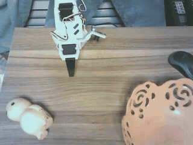
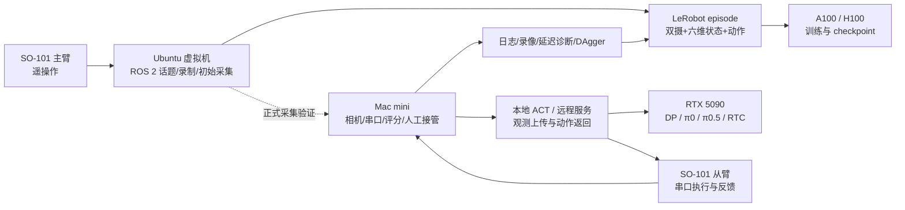

# Real-World Imitation Learning and VLA Benchmarking on SO-101

一个基于 SO-101 机械臂的 Robot Learning 项目。以“抓取软体玩偶并放入篮子”为任务，串起主从示范、数据清洗、多种 Policy 训练、远程推理、串口执行、泛化复测、人工纠正和延迟诊断等。

项目围绕三条问题线展开：

1. **不同 Policy 在硬件上的执行差异**：ACT、Diffusion Policy、π0、π0.5 和 π0.5 Training-Time RTC 在同一任务上的真机表现如何；
2. **固定场景成功与空间泛化之间的差距**：玩偶改变位置后，模型从哪里开始偏移，针对性数据迭代能否改善结果；
3. **远程模型如何接入真实控制回路**：观测时效、网络往返、模型计算、动作块接续和舵机反馈如何共同影响执行。

**ACT · Diffusion Policy · π0 · π0.5 · DAgger · Training-Time RTC**

## 关键结果

| 实验 | 结果 | 范围 |
| --- | --- | --- |
| 固定点位评测 | 47/50，94% | 五种策略，各 10 回合 |
| 玩偶前移 3 cm | 20% → 70% | π0.5 Training-Time RTC + DAgger，各 10 回合 |
| 玩偶侧移 6 cm | 30% → 90% | π0.5 Training-Time RTC + DAgger，各 10 回合 |

## 真机 Demo

素材统一使用顶置相机、统一裁剪和 1.5 倍速播放。

<table>
<tr>
<td><br><b>ACT · 固定位置</b></td>
<td><br><b>Diffusion Policy · 固定位置</b></td>
<td><br><b>π0 · 固定位置</b></td>
</tr>
<tr>
<td><br><b>π0.5 · 固定位置</b></td>
<td><br><b>π0.5 RTC · 固定位置</b></td>
<td><br><b>π0.5 RTC + DAgger · 侧移 6 厘米</b></td>
</tr>
<tr>
<td><br><b>π0.5 RTC + DAgger · 前移 3 厘米</b></td>
<td><br><b>DAgger · 模型出错后人工纠正</b></td>
<td><br><b>DAgger · 模型出错后人工纠正</b></td>
</tr>
</table>

两条 DAgger 轨迹都从模型自主执行开始，模型出现偏移后由人工接管并完成剩余任务。

## 项目闭环

```text
主臂遥操作 / 人工接管 + 从臂反馈 + 顶置/腕部双摄
                           ↓
                 时间对齐、数据记录、归一化
                           ↓
        Mac mini 本地 ACT 或 RTX 5090 远程 Policy 服务
                           ↓
          观测上传 → 模型前向 → 动作块/RTC 接续
                           ↓
             从臂串口执行、反馈记录、人工评分
                           ↓
       模型行为 / 数据分布 / 延迟 / 通信 / 硬件分层诊断
                           ↓
            DAgger 纠正 → 有效窗口 → 混合训练
                           ↓
                    固定点位与位置泛化复测
```

## 系统架构



### 链路分工

- **Ubuntu 虚拟机采集链路**：承担主从遥操作、双摄话题、录制和初始示范数据采集。
- **Mac 直接控制链路**：模型闭环需要更低的观测—动作延迟。虚拟机 USB/话题转发链路的额外时延会压缩动作接续余量，因此模型部署、DAgger 现场接管、回位、评分和延迟诊断改由 Mac mini 直接采集相机并持有从臂串口。
- **模型服务链路**：ACT 使用 Mac mini 的 Apple MPS；Diffusion Policy、π0 和 π0.5 使用 RTX 5090 上的项目 gRPC/RPC 服务；π0.5 Training-Time RTC 使用官方 Zenoh 远程推理链路。

## 硬件与软件

### 真机端

- **机器人**：一对 SO-101 主臂/从臂，共 6 个执行通道（5 个机械臂关节 + 1 个夹爪自由度）；主臂用于示范和人工接管，从臂负责执行；
- **主机**：Apple Mac mini，M4 芯片，10 核 CPU，16 GB 内存，macOS 26.4；
- **相机**：顶置和腕部两路 UVC RGB 相机，640×480，名义 30 FPS；
- **通信**：主臂和从臂分别通过 USB 串口连接 Feetech 舵机总线；Ubuntu 虚拟机中的 ROS 2 承担采集话题，Mac 直接控制链路承担低延迟执行；状态和动作使用六维弧度表示；
- **本地软件**：Python 3.12.15、LeRobot 0.6.2、PyTorch 2.7.1、TorchVision 0.22.1、NumPy 2.2.6、PySerial 3.5。

### 训练与推理端

- **A100 40 GB**：用于 ACT 和 Diffusion Policy 训练；
- **H100 80 GB**：用于 π0、π0.5 和 Training-Time RTC 训练，保存 checkpoint 和归一化统计；
- **RTX 5090**：32 GB 显存，用于远程 Diffusion Policy、π0、π0.5 和 RTC 服务；
- **远程环境**：Python 3.12.15、PyTorch 2.7.1+cu128、TorchVision 0.22.1+cu128、LeRobot 0.6.2、Eclipse Zenoh 1.10.1、Transformers 5.22.1、SentencePiece 0.2.2。

## 数据采集与清洗

### 数据规模

| 阶段 | 数量 | 说明 |
| --- | ---: | --- |
| 原始主从采集 | 160 条 | 主从遥操作得到的原始示范 |
| 统一清洗候选 | 83 条 | 统一核查任务完整性、画面、时间轴、状态和动作，剔除异常或无法可靠对齐的回合 |
| 正式基线训练 | 75 条 | 从清洗候选中确定正式训练清单 |

每个 episode 记录顶置视角、腕部视角、六维 `observation.state`、六维 `action`、时间戳和 episode/frame 索引。DAgger 数据额外保存 `intervention`、原始帧索引和来源时间戳。

| 数据项 | 实际设置 |
| --- | --- |
| 采集方式 | 初始示范经 Ubuntu 虚拟机中的 ROS 2 主从遥操作采集；模型部署和 DAgger 纠正经 Mac 直接控制 |
| 视觉输入 | 顶置相机 + 腕部相机，640×480，名义 30 FPS |
| 状态与动作 | 六维关节/夹爪弧度状态与动作目标 |
| 远程执行频率 | π 系列与 Training-Time RTC 使用 20 Hz；采集时间轴保持 30 FPS |
| 场景变化 | 玩偶摆放、光照和室内外环境覆盖多种真实状态 |

### 数据多样性

采集过程中覆盖了不同摆放位置、光照和室内外场景，后续补采也保留了固定点位条件。

固定点位训练可以稳定完成标准抓取—放置；玩偶移动后，策略会把动作拉回训练中常见的旧位置。这个现象构成后续位置泛化和 DAgger 数据迭代的实验起点。

### 清洗依据

数据清洗分为三层：

1. **技术完整性**：检查四路 ROS 话题、消息数量、时间戳单调性、六维状态/动作、有限值和视频解码；时间轴存在内部缺口、图像损坏或无法解释的回合进入复核。
2. **任务有效性**：人工确认玩偶是否从篮外开始、是否真正夹住、搬运过程中是否掉落、是否进入篮子并在松爪后保持稳定。只把任务成功且技术完整的回合放入成功示范候选。
3. **训练一致性**：核对关节顺序、弧度单位、主从坐标映射、标定范围和图像—状态—动作的时间关系；状态/关节语义异常回合单独隔离，原始文件保留。

## Policy 训练

| Policy | 训练数据 | 步数 | Batch size | 学习率 | 初始化 | Seed | 训练/推理设备 |
| --- | --- | ---: | ---: | ---: | --- | ---: | --- |
| ACT | train75 | 50k | 32 | 1e-5 | - | 1000 | A100 / Mac MPS |
| Diffusion Policy | train75 | 50k | 64 | 1e-4 | - | 1000 | A100 / RTX 5090 |
| π0 | train75 | 20k | 32 | 2.5e-5 | `pi0_base` | 1000 | H100 / RTX 5090 |
| π0.5 | train75 | 20k | 64 | 2.5e-5 | `pi05_base` | 1000 | H100 / RTX 5090 |
| π0.5 Training-Time RTC | train75 | 20k | 64 | 2.5e-5 | `pi05_base` | 1000 | H100 / RTX 5090 |

π0、π0.5 和 Training-Time RTC 都输出固定长度为 50 步的动作块。离线训练配置使用 10 步采样，真机服务将运行采样设为 5 步，以平衡单次计算量和动作更新频率。Training-Time RTC 在 20 Hz 下保留 25 步执行窗口，并允许最多 20 步的接续延迟，使新动作有机会在旧动作块结束前接入。

### 训练曲线


## 真机评测

### 评测协议

- **任务**：从固定起始姿态出发，抓取软体玩偶并放入篮子；
- **评分**：人工在每轮结束后记录任务成功或失败；
- **固定点位**：玩偶和篮子位置保持不变，用于比较不同 Policy 的基础执行能力；
- **位置泛化**：篮子、相机和起点保持不变，只移动玩偶；

### 固定点位

玩偶和篮子保持固定位置，每种策略完成 10 个已评分回合。

| Policy | 成功 | 回合 | 成功率 |
| --- | ---: | ---: | ---: |
| ACT | 10 | 10 | 100% |
| Diffusion Policy | 8 | 10 | 80% |
| π0 | 10 | 10 | 100% |
| π0.5 | 9 | 10 | 90% |
| π0.5 Training-Time RTC | 10 | 10 | 100% |
| **合计** | **47** | **50** | **94%** |

### 位置泛化

位置泛化只使用 π0.5 Training-Time RTC + DAgger。篮子、相机和起点保持不变，只改变玩偶位置。

| 评测条件 | DAgger 前（Before） | DAgger 后（After） | 绝对提升 |
| --- | ---: | ---: | ---: |
| 玩偶前移 3 cm | 2/10（20%） | 7/10（70%） | +50 pp |
| 玩偶侧移 6 cm | 3/10（30%） | 9/10（90%） | +60 pp |

ACT、Diffusion Policy 和 π0 的位置泛化表现较弱，因此没有继续开展对应的位置变化评测。

## DAgger：从失败状态回收训练信号

DAgger 数据聚合围绕真实失败状态展开：

```text
75 条主从示范
      ↓
多种 Policy 训练与固定点位评测
      ↓
玩偶位置变化后仍抓取旧位置
      ↓
模型自主执行 → 暂停 → 主臂粗对齐/精对齐 → 人工完成剩余任务
      ↓
保存完整 episode，并用 intervention 标记动作来源
      ↓
提取连续有效人工窗口 → 与原始示范混合训练
      ↓
前移/侧移泛化复测
```

每条 DAgger episode 从起点开始保存：

- 自主阶段：`intervention=False`；
- 人工接管阶段：`intervention=True`；
- 完整轨迹用于回放、失败归因和 Demo；
- 连续有效人工窗口用于再训练；
- 暂停造成的时间断点不拼接；
- 硬件中止、复位失败和未来动作不足的尾段不进入训练窗口。

本轮共保存 35 条完整 episode，人工纠正部分经过筛选后得到 18,004 帧。该流程属于 Human-in-the-Loop（HIL）纠正：模型先执行，人工在失败状态接管并完成任务。

## 推理链、RTC 与端到端延迟

远程 π0.5 采用异步动作块推理：

```text
相机采集 → SendObservations → RTX 5090 LeRobot 服务
          → GetActions → Mac 动作队列 → 串口控制 → SO-101 从臂
```

Vanilla、Inference-Time RTC 和 Training-Time RTC 都在这条异步链路上运行，区别在动作块如何接续：

| 方案 | 动作接续 | 专用训练 |
| --- | --- | --- |
| Vanilla | 新的 50 步动作块直接进入队列 | 否 |
| Inference-Time RTC | 推理时用旧动作块作为前缀，引导新块接续 | 否，增加推理计算 |
| Training-Time RTC | 训练阶段学习延迟接续，运行时使用训练好的前缀机制 | 是，需要专用 checkpoint |

普通 π0.5 和 Inference-Time RTC 使用 gRPC/RPC；Training-Time RTC 使用 Zenoh。

### 三层延迟口径

下面三组数来自同一观测输入的离线模型测量：每组预热 3 次、测量 20 次，在 RTX 5090 上使用 5 步采样和 50 步动作块。

| 方案 | median | P95 |
| --- | ---: | ---: |
| Vanilla π0.5 | 179.02 ms | 334.06 ms |
| Inference-Time RTC | 250.36 ms | 413.11 ms |
| Training-Time RTC | 164.66 ms | 195.13 ms |

固定点位的两组 RTC 真机记录如下：

| 条件 | 成功率 | 帧年龄 median | 帧年龄 P95 | 相邻命令差 P95 | 离散 jerk P95 |
| --- | ---: | ---: | ---: | ---: | ---: |
| π0.5 Inference-Time RTC | 9/10 | 644.7 ms | 942.8 ms | 0.038 rad | 219.8 rad/s³ |
| π0.5 Training-Time RTC | 10/10 | 514.2 ms | 637.1 ms | 0.032 rad | 182.4 rad/s³ |

当前样本中 Training-Time RTC 的帧年龄和离散动作连续性指标较低，显示出更平稳的接续表现。

## 当前结论

1. 五种策略在固定点位都具备任务执行能力，ACT、π0 和 π0.5 Training-Time RTC 达到 10/10；Diffusion Policy 和 π0.5 分别为 8/10、9/10。
2. 固定点位成功率不能代表位置泛化；针对真实失败状态采集并混合 DAgger 数据后，前移 3 cm 和侧移 6 cm 的成功率分别提升到 70% 和 90%。
3. 真实机器人上的策略效果由模型、数据分布、远程推理、动作接续、相机时效、串口执行和标定合同共同决定，端到端日志是分析这些因素的基础。

## 第三方组件

项目使用并参考 LeRobot、ACT、Diffusion Policy、π0/π0.5 及官方 DAgger/RTC 组件。许可与来源见 [`THIRD_PARTY_NOTICES.md`](THIRD_PARTY_NOTICES.md)。

## License

本仓库原创代码和文档采用 [MIT License](LICENSE)。第三方组件、模型和源材料遵循各自的许可证与版权声明。
